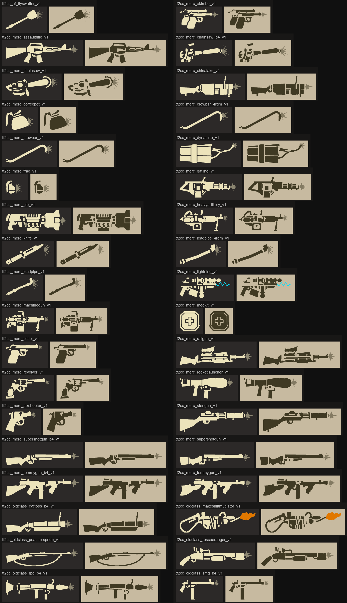
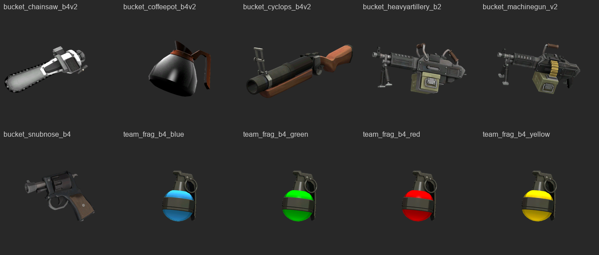

# TF2 Classified weapon icons

Generated kill-feed icons and HUD bucket / armory icons for custom weapons on **TF2 Classified**
(build 5205), plus the scripts that made them. Every icon here is made from the weapon's own 3D
model. None of it is hand-traced or copied from another game's art.

These are the icons used by [tf2cc](https://github.com/AgitationSkeleton/tf2cc-tf2classified)
(the Mercenary / Civilian custom classes for TF2 Classified) for its Open Fortress, MarxVee, old
TF2 Classic beta and 4dm-map weapons. Every icon here was approved by the server owner; the kill icons went through
four review rounds.

* **36 kill-feed icons:** SVG, in TF2 Classified's own death-notice format.
* **10 bucket / armory icons:** PNG previews of the textures the server ships.
* **Tools:** the kill-icon pipeline (model to SVG), the bucket-icon renderers, and a VTF-to-PNG
  decoder.

The code is GPL-3.0. The icons depict other people's weapon models; see
[Licence](#licence) and [CREDITS.md](CREDITS.md).

## Showcase

### Kill-feed icons

Each icon is shown twice: the normal kill-feed look, and the look used when the local player is
the killer or the victim. Both looks come from the same SVG; the game tints it with injected CSS.



| File | Weapon (tf2cc defindex) | Model source |
|---|---|---|
| `tf2cc_merc_crowbar_v1` | Crowbar (30100) | Open Fortress |
| `tf2cc_merc_leadpipe_v1` | Lead Pipe (30101) | Open Fortress |
| `tf2cc_merc_knife_v1` | Knife (30102) | Open Fortress |
| `tf2cc_merc_chainsaw_v1` | Chainsaw (30104) | Open Fortress |
| `tf2cc_merc_pistol_v1` | Pistol (30105) | Open Fortress |
| `tf2cc_merc_akimbo_v1` | Akimbo Pistols (30106) | Open Fortress (pistol, drawn twice) |
| `tf2cc_merc_revolver_v1` | Revolver (30107) | Open Fortress |
| `tf2cc_merc_tommygun_v1` | Tommy Gun (30110) | Open Fortress |
| `tf2cc_merc_dynamite_v1` | Dynamite (30111) | Open Fortress |
| `tf2cc_merc_supershotgun_v1` | Super Shotgun (30112) | Open Fortress |
| `tf2cc_merc_assaultrifle_v1` | Assault Rifle (30113) | Open Fortress |
| `tf2cc_merc_rocketlauncher_v1` | Rocket Launcher (30114) | Open Fortress |
| `tf2cc_merc_chinalake_v1` | Grenade Launcher (30115) | Open Fortress |
| `tf2cc_merc_gatling_v1` | Gatling Gun (30117) | Open Fortress |
| `tf2cc_merc_railgun_v1` | Railgun (30118) | Open Fortress |
| `tf2cc_merc_lightning_v1` | Lightning Gun (30119) | Open Fortress |
| `tf2cc_merc_gib_v1` | BFG / Gib (30120) | Open Fortress |
| `tf2cc_merc_machinegun_v1` | Machine Gun (30150) | MarxVee pack |
| `tf2cc_merc_medkit_v1` | Medkit (30151) | MarxVee pack |
| `tf2cc_merc_crowbar_4rdm_v1` | Crowbar, old Merc (30202) | 4dm/4rdm map set |
| `tf2cc_merc_supershotgun_b4_v1` | Super Shotgun, beta 4 (30203) | TF2 Classic 2.0.0 beta 4 |
| `tf2cc_merc_chainsaw_b4_v1` | Chainsaw (Classic) (30204) | TF2 Classic 2.0.0 beta 4 |
| `tf2cc_merc_tommygun_b4_v1` | Tommy Gun, beta 4 (30205) | TF2 Classic 2.0.0 beta 4 |
| `tf2cc_merc_leadpipe_4rdm_v1` | Lead Pipe, old Merc (30206) | 4dm/4rdm map set |
| `tf2cc_merc_sixshooter_v1` | Six-Shooter (30210) | TF2 Classic 2.0.0 beta 4 |
| `tf2cc_merc_frag_v1` | Frag Grenade (30211) | TF2 Classic 2.0.0 beta 4 (TF2 Workshop grenade) |
| `tf2cc_merc_heavyartillery_v1` | Heavy Artillery (30212) | TF2 Classic 2.0.0 beta 2 |
| `tf2cc_merc_stengun_v1` | Sten Gun (30213, 30302, 30303) | TF2 Classic beta, 4dm/4rdm map set |
| `tf2cc_merc_coffeepot_v1` | Coffee Pot (30226) | 4dm/4rdm map set |
| `tf2cc_oldclass_rescueranger_v1` | Rescue Ranger (30300) | Valve (TF2), via TF2 Classic 2.2.3 |
| `tf2cc_oldclass_poacherspride_v1` | Poacher's Pride (30301) | TF2 Classic 2.0.0 beta 4 |
| `tf2cc_oldclass_smg_b4_v1` | Scout's SMG (30305) | TF2 Classic 2.0.0 beta 2/4 |
| `tf2cc_oldclass_cyclops_b4_v1` | Beta Cyclops (30306) | TF2 Classic 2.0.0 beta 4 |
| `tf2cc_oldclass_rpg_b4_v1` | Beta R.P.G. (30307) | TF2 Classic 2.0.0 beta 4 |
| `tf2cc_oldclass_makeshiftmutilator_v1` | Makeshift Mutilator (30310) | Valve (TF2), via TF2 Classic 2.2.3 |
| `tf2cc_af_flyswatter_v1` | Flyswatter (April Fools item 17502) | TF2 Classified April Fools 2026 |

Files: [`icons/killicons/svg/`](icons/killicons/svg) (the icons) and
[`icons/killicons/png/`](icons/killicons/png) (`_normal` / `_local` previews at 3x).

### Bucket / armory icons

The whole 512x512 texture of each icon is shown, so you can compare sizes as they appear on the HUD.



| File | Weapon (tf2cc defindex) | Model source | How it was made |
|---|---|---|---|
| `bucket_machinegun_v2` | Machine Gun (30150) | MarxVee pack | `render_old_icons.py`: three-quarter shot (22° yaw, 10° pitch) along the muzzle axis, framed like the Open Fortress bucket sprites |
| `bucket_heavyartillery_b2` | Heavy Artillery (30212) | TF2 Classic 2.0.0 beta 2 | `render_old_icons.py`, muzzle axis, framed like the old TF2 Classic sprites |
| `bucket_snubnose_b4` | Six-Shooter (30210) | TF2 Classic 2.0.0 beta 4 | `render_old_icons.py`, muzzle axis, flipped vertically and rolled 5° to level the barrel |
| `bucket_chainsaw_b4v2` | Chainsaw (Classic) (30204) | TF2 Classic 2.0.0 beta 4 | `render_fit_icons.py`: camera fitted to the silhouette of Open Fortress's chainsaw icon |
| `bucket_cyclops_b4v2` | Beta Cyclops (30306) | TF2 Classic 2.0.0 beta 4 | `render_fit_icons.py`: camera fitted to TF2 Classified's stock grenade-launcher icon |
| `bucket_coffeepot_b4v2` | Coffee Pot (30226) | 4dm/4rdm map set | `render_fit_icons.py`: upright view (yaw 30°), scaled to 0.50 of the canvas height so its area roughly matches the stock Jarate icon |
| `team_frag_b4_red/blue/green/yellow` | Frag Grenade (30211) | TF2 Classic 2.0.0 beta 4 (TF2 Workshop grenade) | `render_fit_icons.py`: upright view, one render per team skin, scaled to 0.45 of the canvas height to match the stock small-item buckets |

The PNGs in [`icons/bucket/`](icons/bucket) were decoded (with `tools/bucket/vtf2png.py`) from the
512x512 DXT5 textures that the live server ships. The VTF game files are not included here; the
tools write them for you.

## How the kill icons work in TF2 Classified

Found by reverse engineering the 5205 client:

* **Loaded from disk at game start.** The death-notice HUD enumerates
  `resource/svgs/deathnotice/*.svg` across all search paths the first time it applies its scheme,
  and rasterises each file with lunasvg. The file stem is the icon name. A weapon uses it through
  its schema key `"item_iconname" "<name>"`.
* **This includes `download/`.** `.svg` passes the engine's download filter, so a server can send
  the icons through FastDL and the downloads table. Because the scan runs only once per launch,
  a player sees a new icon **after one game restart** following the download. Until then the
  kill feed shows text. Icons cannot appear mid-session, and a server cannot override stock
  icon names this way. This was confirmed in game.
* **One file per weapon.** The event's weapon name `X` is looked up as `d_X` (normal) and
  `dneg_X` (the local player is involved). Both resolve to the same `X.svg`, which is drawn twice
  with injected CSS fills (236 227 187 normal, 63 57 35 negative). The crit, mini-crit and similar
  badges are separate generic icons.
* **Never reuse a published name.** FastDL clients never download a path they already have, so a
  changed icon needs a new name (`_v2`) and a matching `item_iconname` change.

## How the kill-icon style was derived

The 96 stock TF2 Classified death-notice SVGs were measured with `svgras.py` (a small
SVG rasteriser). The generator targets those numbers, and every output is checked against them:

| Metric (stock) | Value |
|---|---|
| Canvas | `viewBox="0 0 W 32"`: height **always 32 units**, width 32–135 (median 79) |
| Strokes | none: flat single-colour silhouettes, tinted at runtime |
| Interior detail | **negative-space gap cuts**, median **1.17 units** wide (p25 0.8, p75 1.4) |
| Parts | 3–21 separate pieces (median 5); fill ratio 0.11–0.74 of the bounding box |
| Thin parts | median thickness 3.0 units; rods down to ~1.2; corners rounded 0.3–0.7 |
| Effects | a **half-opacity layer** (`.cls-1{opacity:.5}`): muzzle burst on the right for guns, impact star on melee; a few icons use literal colours (flame `#e17800`, zap `#00e1ff`) |
| Layout | guns muzzle-right, grip bottom-left; melee head up-right at about 28° |

The pipeline (`tools/killicons/`) does the following for each icon:

1. **kimodel.py** loads the world model (or the viewmodel's weapon meshes) straight from the game's
   VPKs and loose folders. It poses a true side profile: forward is the muzzle attachment's axis
   or the principal axis, the view is the thinnest direction, and the barrel is placed above the
   grip. It then rasterises orthographic mask / part-id / depth / normal buffers at 16 px per
   icon unit, with one uniform scale (true proportions).
2. **kistyle.py** stylises the result. It places 1.1-unit gap cuts at part, depth and crease
   boundaries (at most 8, at least 3 units long), inflates thin parts to at least 1.6 units,
   fills tiny holes, drops islands and rounds corners.
3. **kitrace.py** traces the result with a crack tracer plus RDP simplification and adds an
   effect layer. The effects are original shapes drawn in the stock manner and seeded by the
   icon name, so they are reproducible. It then writes the stock SVG subset: `svg/defs/style/path`,
   class selectors only, no body fill.
4. **killicons.py** validates each icon against the stock ranges (viewBox, fill ratio, parts,
   thickness, padding, size of 12 KB or less). Its `review` command renders previews and an HTML
   review page.

[`tools/killicons/manifest.json`](tools/killicons/manifest.json) lists each icon's model, family
(gun / melee / thrown / flame / beam), the stock icon it was compared with, per-icon pose
overrides, and the review notes from each round.

## How the bucket icons are made

The bucket and armory icons use the **v2 renderer** of
[tf2c-customslop](https://github.com/AgitationSkeleton/tf2c-customslop) (GPL-3.0). That software
renderer was written to give CustomSlop's daily random weapons icons that sit next to stock ones.
These scripts import it read-only from a checkout; it is not vendored here.

* **Donor-icon camera fit** (`render_fit_icons.py`): `iconfit.fit_v2` searches camera rotations
  until the model's silhouette best matches a reference icon, such as a stock TF2 Classified icon
  or the Open Fortress sprite the weapon replaces. Items with no fitting pose use a fixed upright
  view instead.
* **TF2 Classified shading**: each material's VMT is read. TF2C's weapon materials use full
  Lambert (`$PhongDisableHalfLambert`) through `$lightwarptexture` (Source's 2x warp), plus phong
  with exponent and mask textures, rim light and an ambient cube. A single light rig was
  calibrated against 16 stock icons.
* **Premultiplied edges**: renders are supersampled and downsampled with premultiplied alpha, so
  edges have no dark or light halo over the HUD.
* **Armory format**: TF2 Classified's armory draws the item texture at its own size with wrapping
  UVs. Icons are therefore 512x512, DXT5, one mip, with the clamp flags
  `CLAMPS|CLAMPT|NOMIP|NOLOD|EIGHTBITALPHA` (0x230C), the same as the stock
  `vgui/loadout/weapons` icons. `dxt.py` is a small numpy DXT5 encoder for that.
* **Old-sprite framing** (`render_old_icons.py`): weapons that replace old TF2 Classic or Open
  Fortress items get the same three-quarter, muzzle-left 256x128 framing as those sprites. The
  script also writes the 512x512 square version.

## Usage

Requirements: Python 3, `numpy`, `Pillow`, and `scipy` (kill icons only).

```sh
pip install -r requirements.txt
cp config.example.json config.json     # then edit the paths
```

`config.json` keys are documented in [`tools/iconcfg.py`](tools/iconcfg.py):

| Key | Used by | Meaning |
|---|---|---|
| `tf2c_game_dir` | all | your TF2 Classified `tf2classified` folder (`custom/`, `vpks/`) |
| `tf2_dir`, `tf2_client_dir` | all (optional) | a TF2 install (`tf/`, `hl2/` VPKs) for shared textures |
| `search_extra` | all (optional) | extra `["dir"/"vpk", path]` sources, e.g. a mod's asset tree |
| `staging_dir` | bucket | loose tree with the models and materials to render |
| `customslop_tools` | bucket | the `tools/` folder of a tf2c-customslop checkout |
| `out_dir` | all | output folder (default `out/`) |

The models in `manifest.json` and the bucket scripts use tf2cc's asset paths
(`models/tf2cc/...`). Install tf2cc's `custom/` content, or point `search_extra` / `staging_dir`
at its asset tree. To make icons for other weapons, edit the manifest, `ICONS` or `FIT`.

```sh
# kill icons: build SVGs (all, or named ones), then previews + review page
python -B tools/killicons/killicons.py build  [--config config.json] [name ...]
python -B tools/killicons/killicons.py review [--stock path/to/stock/deathnotice]
python -B tools/killicons/killicons.py check  some_icon.svg

# bucket icons
python -B tools/bucket/render_old_icons.py  [name ...]   # old-sprite framing
python -B tools/bucket/render_fit_icons.py  [name ...]   # fitted to a reference icon
python -B tools/bucket/vtf2png.py icon.vtf icon.png [--crop]

# this repo's previews and contact sheets
python -B tools/make_showcase.py
```

With the same game files, `killicons.py build` reproduces the shipped SVGs byte for byte. The
bucket renderers match the shipped textures up to DXT5 rounding.

**Shipping kill icons from a server:** put `<name>.svg` under
`tf2classified/custom/<yourpack>/resource/svgs/deathnotice/`, set `"item_iconname" "<name>"` on
the item in your schema, and add `resource/svgs/deathnotice/<name>.svg` to your downloads table
and FastDL. Players see the icon after downloading it and restarting the game once.

## Limitations

* The kill icons are automatic silhouettes. Most needed per-icon pose overrides (flips, roll,
  cut limits) during review. Odd shapes, such as round or boxy items, can still read poorly at
  1x. Two shipped icons sit just outside one stock range (BFG: 23 parts; Medkit: fill ratio
  0.73), and both were accepted in review.
* Kill icons only work on TF2 Classified (5205's SVG death notices). Players need one game
  restart after the first download.
* The bucket renderer is a software rasteriser that approximates Source shading. It has no
  real-time effects, and self-illumination is turned off.
* The tools read MDL v48 / VVD v4 / VTX v7 (SDK 2013) models and VTF formats RGBA8888,
  BGRA8888 and DXT5 only.
* The repository does not include any game files, stock TF2 Classified icons, VTF textures or
  models. The tools need your own game install.

## Licence

**Code** (everything under `tools/`): GPL-3.0, see [LICENSE](LICENSE). The bucket tools use
[tf2c-customslop](https://github.com/AgitationSkeleton/tf2c-customslop)'s renderer (also GPL-3.0)
at run time. `tools/srcmodel.py` is the same loader that ships in tf2c-customslop.

**Icons** (everything under `icons/` and `docs/`): these are derived depictions of weapon models
made by the teams and people in [CREDITS.md](CREDITS.md), who keep the rights to their designs.
They are provided for use on TF2 Classified servers and in mods, with credit to those creators
and to this repository. They are not covered by the GPL and must not be sold. TF2 Classified's
own stock icons are not included here; they are only referred to by name.
